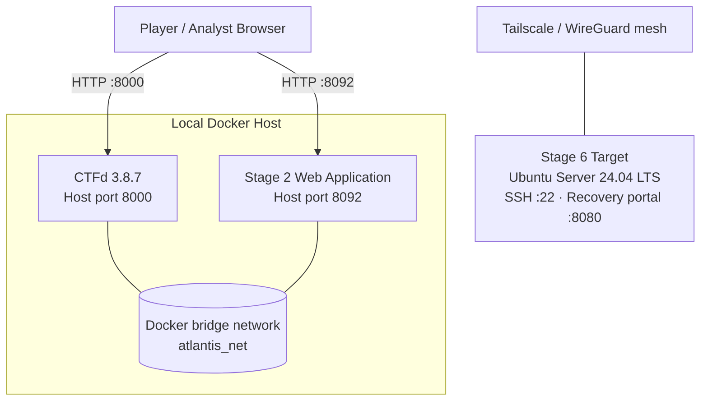

# 🌊 Atlantis CTF — Incident 042

A six-stage, underwater-themed Capture The Flag (CTF) lab built for **IE3132 — Penetration Testing** at the **Sri Lanka Institute of Information Technology (SLIIT)**.

[](https://docs.docker.com/compose/)
[](https://ctfd.io/)
[](https://www.sliit.lk/)
[](#project-scope)

> **Assignment:** Assignment 02 — Final Implementation and Working Box Demonstration  
> **Group:** 21  
> **Purpose:** Controlled academic security testing and demonstration

---

## Table of Contents

- [Overview](#overview)
- [Project Scope](#project-scope)
- [Challenge Overview](#challenge-overview)
- [Architecture](#architecture)
- [Technology Stack](#technology-stack)
- [Prerequisites](#prerequisites)
- [Deployment](#deployment)
- [Reset and Recovery](#reset-and-recovery)
- [Solver Verification](#solver-verification)
- [Repository Structure](#repository-structure)
- [Team Contributions](#team-contributions)
- [Security and Ethical Use](#security-and-ethical-use)

## Overview

**Atlantis CTF — Incident 042** is a fictional incident-response exercise set in the underwater civilisation of Atlantis. Players investigate a breach attributed to an unknown intruder known as *the Surface Raider*. Across six challenges, participants collect and analyse evidence, uncover hidden data, investigate a web-session weakness, and work through progressively more advanced security scenarios.

The challenge set combines practical tasks in steganography, web security, cryptography, digital forensics, network traffic analysis, and Linux system security. CTFd provides the competition interface and scoreboard, while Docker Compose and a separate virtual machine support the lab environment.

## Project Scope

The project demonstrates how to build, deploy, reset, and validate a multi-stage CTF environment for a controlled lab. It includes:

- A CTFd-based challenge platform and scoreboard.
- Six challenges with a combined maximum score of **1,300 points**.
- A containerised Stage 2 web application.
- A separate Ubuntu Server target for the Stage 6 capstone.
- Reset tooling and Python solver scripts for repeatable validation.
- Supporting test notes and a Stage 2 security review.

## Challenge Overview

All challenges use the flag format `Atlantis{...}`. **Flag values are intentionally not published in this README** so the documentation does not immediately disclose every answer.

| Stage | Challenge | Primary Domain | Difficulty | Points |
|:---:|---|---|:---:|---:|
| 01 | The Lost Sonar Echo | Steganography | Easy | 100 |
| 02 | Tide-Keeper Hijack | Web security | Easy | 100 |
| 03 | The Crystal Briefcase | Cryptography — repeating-key XOR | Moderate | 200 |
| 04 | Echoes of the Deep | Digital forensics and AES decryption | Moderate | 200 |
| 05 | Deep Signal Pursuit | Network traffic / PCAP analysis | Moderate–Hard | 300 |
| 06 | The Final Tide | Linux and system security | Hard | 400 |
|  | **Total** |  |  | **1,300** |

## Architecture

The CTFd platform and Stage 2 web challenge run on the local Docker host. Stage 6 is hosted separately in an Ubuntu Server virtual machine and is reached through the configured lab mesh network.



The diagram is a logical overview; actual reachability depends on the deployed Docker, host-firewall, and Tailscale configuration.

## Technology Stack

| Component | Purpose |
|---|---|
| CTFd 3.8.7 | Challenge delivery, submissions, and scoreboard |
| Docker Compose | Local platform and web-challenge orchestration |
| Flask and Nginx | Stage 2 web application and gateway, as configured for the lab |
| Redis and MariaDB | Supporting services for the CTFd stack |
| Ubuntu Server 24.04 LTS | Stage 6 virtual-machine target |
| Tailscale | Private mesh connectivity to the remote lab target |
| Python 3.10+ | Running the challenge solver scripts |

## Prerequisites

Install or prepare the following before deployment:

- [Docker Desktop](https://www.docker.com/products/docker-desktop/) with Docker Compose support (Docker Engine 24.0+ recommended).
- [Git](https://git-scm.com/).
- Python 3.10 or later, if you intend to run the solver scripts.
- The configured Ubuntu Server virtual machine and Tailscale access for Stage 6.

## Deployment

Run these commands from a terminal on the machine where you want to host the local platform.

### 1. Clone the repository

```powershell
git clone https://github.com/niduwara-j/atlantis-deep-sea-breach.git
cd atlantis-deep-sea-breach
```

### 2. Start the Docker services

From the repository root, run:

```powershell
docker compose -f platform/docker-compose.yml up -d
```

To inspect service status and startup logs:

```powershell
docker compose -f platform/docker-compose.yml ps
docker compose -f platform/docker-compose.yml logs
```

Once the relevant services are healthy, open:

- **CTFd scoreboard:** [http://localhost:8000](http://localhost:8000)
- **Stage 2 web challenge:** [http://localhost:8092/session-hijack/](http://localhost:8092/session-hijack/)

Stage 6 requires the separately configured Ubuntu Server virtual machine and authorised Tailscale connectivity; starting Docker Compose alone does not provision that VM.

### 3. Stop the Docker services

To stop the stack without explicitly deleting its named volumes, run:

```powershell
docker compose -f platform/docker-compose.yml down
```

## Reset and Recovery

From the repository root, run the PowerShell reset script:

```powershell
.\platform\reset.ps1
```

Review the script before executing it, especially if you have data in the local lab environment that must be preserved. Reset behaviour depends on the commands implemented in the script and the state of the Docker services.

## Solver Verification

The repository includes Python scripts intended to demonstrate that each challenge is solvable and to support repeatable validation. Run them from the repository root in an appropriately configured lab:

```powershell
python solvers/solve_stage1.py
python solvers/solve_stage2.py
python solvers/solve_stage3.py
python solvers/solve_stage4.py
python solvers/solve_stage5.py
python solvers/solve_stage6.py
```

Stage 6 verification depends on the target VM being available and on the required lab access being configured. Python dependencies, if any, should be installed before running a solver.

> **Maintainer note:** Solver scripts can disclose intended solutions. If this repository will be used to run a live competition for participants, keep the solver scripts in a maintainer-only location or distribute them only after the event. They are included here for academic review and validation.

## Repository Structure

```text
atlantis-deep-sea-breach/
├── platform/
│   ├── docker-compose.yml          # CTFd stack and supporting service configuration
│   └── reset.ps1                   # PowerShell lab reset script
├── challenges/
│   ├── stage1-the-lost-sonar-echo/
│   ├── stage2-session-hijack/
│   ├── stage3-the-crystal-briefcase/
│   ├── stage4-echoes-of-the-deep/
│   ├── stage5-deep-signal-pursuit/
│   └── stage6-the-final-tide/
├── solvers/
│   ├── solve_stage1.py
│   ├── solve_stage2.py
│   ├── solve_stage3.py
│   ├── solve_stage4.py
│   ├── solve_stage5.py
│   └── solve_stage6.py
├── testing/
│   ├── test_cases.md
│   └── stage2_security_review.md
└── README.md
```


## Team Contributions

| Contributor | Responsibility | Assigned Work |
|---|---|---|
| Jayasiri D.N.D | Platform and architecture | CTFd stack, network layout, reset tooling, Stage 6 capstone |
| Pavitha M | Steganography and cryptography | Stage 1 and Stage 3 |
| Prabodini M.A.V | Web security | Stage 2 and OWASP category analysis |
| Dijenthini M.X | Forensics and networking | Stages 4 and 5, integration testing |

## Security and Ethical Use

This project was developed for academic demonstration in **IE3132 — Penetration Testing** at SLIIT. Vulnerable applications, sample artefacts, packet captures, telemetry, and logs are intended for controlled laboratory use.

- Run the challenges only in an environment you own or are explicitly authorised to use.
- Do not expose intentionally vulnerable challenge services directly to the public internet.
- Treat network isolation and container restrictions as defence-in-depth controls, not as a guarantee of security; review the actual deployed configuration before use.
- Use synthetic data and lab-only credentials. Do not use real accounts, production systems, or third-party data in the exercises.

**This is an educational CTF environment, not a production-ready security platform.**
